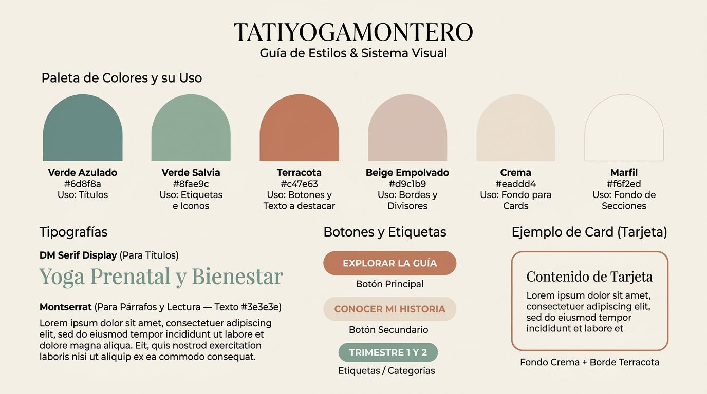

# 🌿 Infografía de Estilos y Guía Visual — TATIYOGAMONTERO



Guía de referencia rápida y estructura de diseño con las variables definidas en `globals.css` y su implementación directa en clases de **Tailwind CSS**.

---

## 1. Paleta de Colores y su Uso

| Color | Uso Visual (Para Diseño y Contenido) | Variable `globals.css` | Hexadecimal |
| :--- | :--- | :--- | :--- |
| 🪨 **Verde Azulado** | **Títulos** principales y encabezados | `--color-verde-azulado` | `#6d8f8a` |
| 🍃 **Verde Salvia** | **Etiquetas e Iconos** (categorías, checks y detalles suaves) | `--color-verde-salvia` | `#8fae9c` |
| 🧱 **Terracota** | **Botones, enlaces y texto a destacar** | `--color-terracota` | `#c47e63` |
| 🌾 **Beige Empolvado** | **Bordes y divisores** sutiles | `--color-beige-empolvado` | `#d9c1b9` |
| 🥛 **Crema** | **Fondo para Cards** (tarjetas), contenedores y botón secundario | `--color-crema` | `#eaddd4` |
| 🐚 **Marfil** | **Fondo de secciones** e interior de casillas de formulario | `--color-marfil` | `#f6f2ed` |
| ☕ **Texto Base** | **Párrafos y lectura** general | `--text-color` | `#3e3e3e` |

---

## 2. ¿Dónde usar el Verde Salvia (`--color-verde-salvia: #8fae9c`)?

El verde salvia es un tono orgánico y calmante muy apropiado para yoga prenatal. Aquí tienes los mejores casos de uso:

1. **Badges / Chips de información:**
   - Etiquetas de categoría (ej: *"Trimestre 1"*, *"Nivel Suave"*, *"Respiración y Calma"*).
   - *Clase sugerida:* `bg-[var(--color-verde-salvia)]/20 text-[var(--color-verde-azulado)] px-3 py-1 rounded-full text-xs font-semibold`
2. **Iconos y viñetas (Checkmarks):**
   - Ticks de listas de beneficios (✓) o íconos florales/posturales.
   - *Clase sugerida:* `text-[var(--color-verde-salvia)]`
3. **Bordes activos / Focus:**
   - Iluminar el contorno de una card seleccionada o un input en foco.
   - *Clase sugerida:* `focus:ring-2 focus:ring-[var(--color-verde-salvia)]` o `border-[var(--color-verde-salvia)]`
4. **Botón secundario suave o WhatsApp:**
   - Botón terciario para contactar o ver detalles sin competir visualmente con el terracota.
   - *Clase sugerida:* `bg-[var(--color-verde-salvia)] text-white hover:opacity-90`

---

## 3. Tipografías

| Aplicación | Variable CSS | Fuente |
| :--- | :--- | :--- |
| **Títulos** (H1, H2, H3, H4) | `--font-dm-serif` | DM Serif Display |
| **Párrafos y Lectura** | `--font-montserrat` | Montserrat |
| **Botones y Enlaces** | `--font-montserrat` | Montserrat |
| **Badges / Etiquetas** | `--font-montserrat` | Montserrat |

---

## 4. Componentes y Estados Hover

### A. Títulos (Headings)
- **H1 (Principal):**
  ```html
  <h1 className="font-[var(--font-dm-serif)] text-[var(--color-verde-azulado)] text-3xl md:text-5xl font-normal leading-tight">
    YOGA PRENATAL PARA ACOMPAÑARTE
  </h1>
  ```
- **H2 (Sección):**
  ```html
  <h2 className="font-[var(--font-dm-serif)] text-[var(--color-verde-azulado)] text-2xl md:text-4xl font-normal">
    Conoce Nuestras Clases
  </h2>
  ```

---

### B. Párrafos
```html
<p className="font-[var(--font-montserrat)] text-[#3e3e3e] text-base leading-relaxed">
  Yoga prenatal, movimiento, respiración y herramientas para acompañarte durante tu embarazo.
</p>
```

---

### C. Botón Primario (Terracota + Blanco)
- **Uso:** Llamadas a la acción principales (CTA), compra, registro.
- **Clases:**
  ```html
  <button className="font-[var(--font-montserrat)] bg-[var(--color-terracota)] text-white font-medium py-2 px-6 rounded-lg shadow-sm transition-all duration-200 hover:opacity-90 active:scale-98">
    Botón Primario
  </button>
  ```
- **Hover:** `hover:opacity-90` (o `hover:bg-[#b06f57]`)

---

### D. Botón Secundario (Crema + Terracota)
- **Uso:** Acciones secundarias, "Conocer mi historia", "Ver más".
- **Clases:**
  ```html
  <button className="font-[var(--font-montserrat)] bg-[var(--color-crema)] text-[var(--color-terracota)] font-medium py-2 px-6 rounded-lg transition-all duration-200 hover:bg-[var(--color-beige-empolvado)] active:scale-98">
    Botón Secundario
  </button>
  ```
- **Hover:** `hover:bg-[var(--color-beige-empolvado)]` (o `hover:opacity-90`)

---

### E. Enlaces (Links inline)
- **Uso:** Links de navegación en textos y enlaces al pie.
- **Clases:**
  ```html
  <a href="#" className="font-[var(--font-montserrat)] text-[var(--color-terracota)] font-medium transition-colors duration-200 hover:text-[#7a4c36] hover:underline underline-offset-4">
    Botón Terciario
  </a>
  ```
- **Hover:** `hover:text-[#7a4c36]` o `hover:opacity-80`

---

### F. Cards / Tarjetas de Contenido
- **Uso:** Bloques de cursos, testimonios, módulos o beneficios.
- **Clases:**
  ```html
  <div className="bg-[var(--color-crema)] border border-[var(--color-terracota)] rounded-xl p-6 shadow-sm transition-shadow duration-200 hover:shadow-md">
    <!-- Contenido de la card -->
  </div>
  ```
- **Estilo:** Fondo crema con borde definido en terracota.

---

### G. Fondos de Secciones
- **Fondo de Sección Base / Contraste Suave:**
  ```html
  <section className="bg-[var(--color-marfil)] py-12 px-6">
    <!-- Contenido -->
  </section>
  ```
- **Fondo de Sección Destacada / Módulos:**
  ```html
  <section className="bg-[var(--color-crema)] py-12 px-6">
    <!-- Contenido -->
  </section>
  ```

---

### H. Badges / Chips Informativos (con Verde Salvia)
- **Uso:** Categorías, niveles o estado de cursos.
- **Clases:**
  ```html
  <span className="inline-block bg-[var(--color-verde-salvia)]/20 text-[var(--color-verde-azulado)] font-[var(--font-montserrat)] text-xs font-semibold px-3 py-1 rounded-full">
    TRIMESTRE 1 Y 2
  </span>
  ```

---

## 5. Resumen "Copiar y Pegar" (Cheat Sheet)

```bash
# TIPOGRAFÍAS
Títulos:             font-[var(--font-dm-serif)]
Textos y botones:    font-[var(--font-montserrat)]

# COLORES DE TEXTO
Títulos:             text-[var(--color-verde-azulado)]
Párrafos:            text-[#3e3e3e]
Enlaces / CTA:       text-[var(--color-terracota)]
Hover de Enlaces:    hover:text-[#7a4c36]

# FONDOS
Secciones suaves:    bg-[var(--color-marfil)]
Cards y contenedores:bg-[var(--color-crema)]
Bordes de Cards:     border-[var(--color-terracota)]

# BOTONES
Botón Terracota:     bg-[var(--color-terracota)] text-white hover:opacity-90
Botón Crema:         bg-[var(--color-crema)] text-[var(--color-terracota)] hover:bg-[var(--color-beige-empolvado)]
Botón Salvia:        bg-[var(--color-verde-salvia)] text-white hover:opacity-90
```
